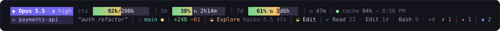

<div align="center">

# ◆ Claude Power Statusline

**A status line for Claude Code, built for engineering work.**

Context, plan limits, cache, git and live agent activity. One glance, no context switch.



</div>

## Install

```sh
npx github:7ahery/claude-power-statusline
```

Needs Node 18+ and a truecolor terminal. Run it again to update.

## Read it

| | |
|---|---|
| `◆ Opus 5.5 ◑ high` | model and effort |
| `ctx 92k/200k` | context used. The fill heats green → red, `▲` from 80% |
| `5h` `7d` | plan usage and time until reset `↻` |
| `● cache 94% → 8:56 PM` | prompt cache: warm, expiring or cold · hit rate · expiry |
| `◇ payments-api` `“auth refactor”` | project (clickable) and session name |
| `⎇ main ●` | branch, uncommitted changes, ahead/behind |
| `+248 −61` | lines changed this session |
| `◐ Explore` `◐ Edit` | agents and tools running right now |
| `✓ Read 22 · Edit 14` `✗ 1` | completed tool calls and errors |
| `✦` `◈` | skills and MCP servers in play |

Narrow window? Segments shrink evenly, then the least useful drop out. Context never does.

## Options

```sh
npx github:7ahery/claude-power-statusline --cost         # show session cost (add --cost-rate for $/h)
npx github:7ahery/claude-power-statusline --refresh 5    # redraw every 5s (default 2)
npx github:7ahery/claude-power-statusline --uninstall    # restore your previous status line
```

## Built for long sessions

One file, zero dependencies. The session log is read incrementally and git is cached for 5s, so a redraw costs about 80 ms however long you've been working.

---

<sub>MIT · Inspired by [kcchien/claude-code-statusline](https://github.com/kcchien/claude-code-statusline) and [claude-hud](https://github.com/jarrodwatts/claude-hud)</sub>
